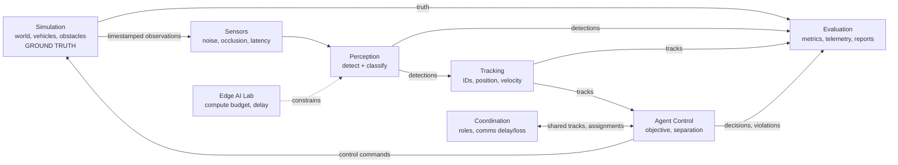

# Architecture overview

> Status: **agreed structure, nothing implemented** (2026-10-12). Modules are created only when their milestone starts.

## Guiding idea: truth vs belief

Only **Simulation** (which owns it) and **Evaluation** (which scores against it) may read ground truth. Every other module sees only observations and its own estimates. This is the same world/belief split as RoverCore, and it is what makes perception and tracking errors measurable.

## Data flow (one simulation step)



## Code layers

| Layer | Assembly | Depends on Unity? | Tested by |
|---|---|---|---|
| Core logic | `AegisSim.Core` (`noEngineReferences`) | No | Edit Mode tests (fast, no scene) |
| Runtime adapters | `AegisSim.Runtime` | Yes (MonoBehaviours) | Play Mode tests + manual |
| Presentation | inside Runtime at first (debug drawing, UI) | Yes | Manual |
| Offline analysis | `ml/` (Python, from M3) | No | pytest |

```
AegisSim.Tests.EditMode ──▶ AegisSim.Core ◀── AegisSim.Runtime ◀── AegisSim.Tests.PlayMode
```

Arrows point from the code that uses to the code it uses. Core depends on nothing, so it never breaks because of a scene change.

## Module boundaries (planned folders inside Core)

`Maths` is the one shared folder: modules depend on it, it depends on nothing. It lives outside `Simulation` so that Tracking, Control and the rest can use vectors without a `using AegisSim.Simulation;` line, which would also expose ground truth (session 7, 2026-10-15).


| Module | Owns | Must not |
|---|---|---|
| Maths (shared, M1-3) | `Vec3` and other plain maths types used by every module | Depend on any other module, or hold simulation state |
| Simulation | Vehicle state, integration, arena, seeds, time | Know about perception or scoring |
| Sensors | Turning truth into observations | Pass truth through unchanged |
| Perception | Detections and class confidence | Read truth |
| Tracking | Track lifecycle and estimates | Read truth |
| Control | Commands under separation constraints | Read truth; reward collisions |
| Coordination | Team roles and messaging | Bypass simulated comms delay/loss |
| Evaluation | Metrics, telemetry, violations | Influence agent decisions |
